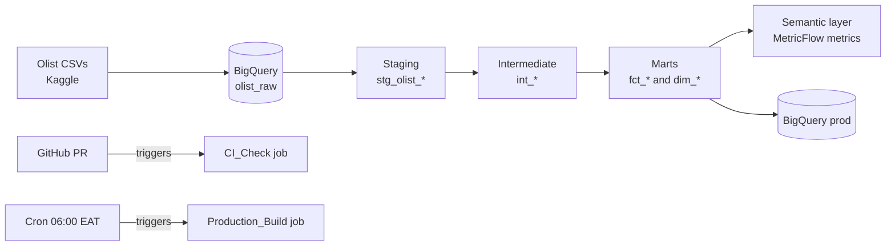
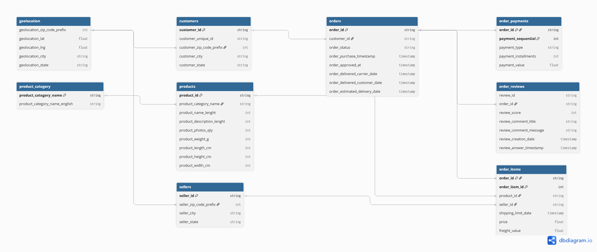
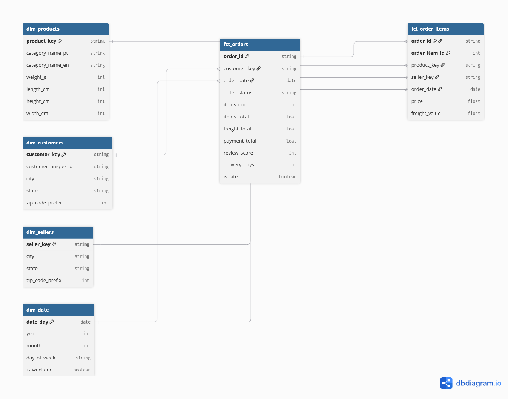
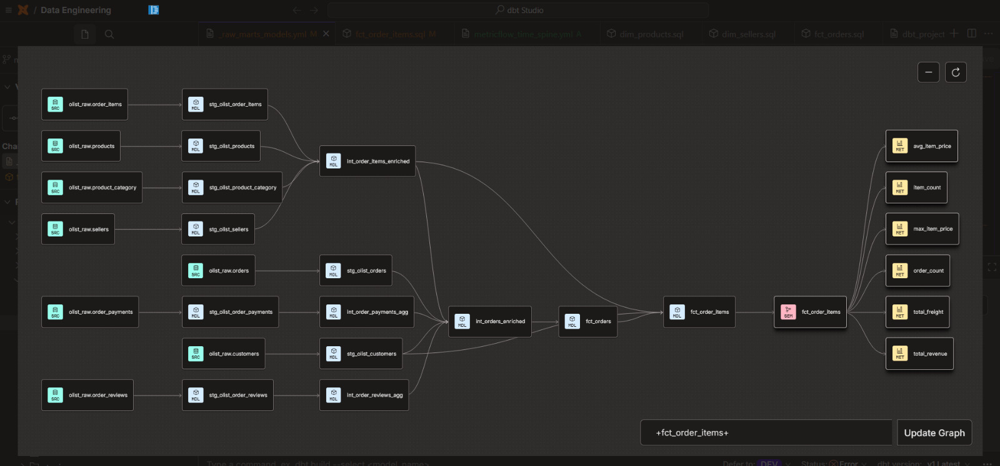
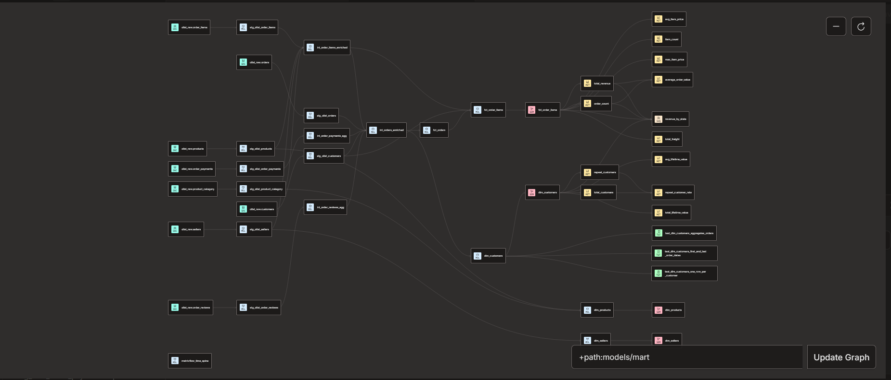

# Olist E-commerce Analytics: dbt Cloud + BigQuery


An end-to-end analytics engineering project built on the **Olist Brazilian e-commerce dataset**. Raw CSVs are loaded into BigQuery, then transformed with dbt Cloud through staging, intermediate and mart layers into a star schema. A semantic layer (MetricFlow) exposes business metrics, and CI/CD runs automatically with no manual steps.

---

## Table of contents
1. [Project overview](#project-overview)
2. [Architecture](#architecture)
3. [Data model](#data-model)
4. [Lineage](#lineage)
5. [Semantic layer and metrics](#semantic-layer-and-metrics)
6. [Testing and data quality](#testing-and-data-quality)
7. [CI/CD](#cicd)
8. [Git workflow](#git-workflow)
9. [Project structure](#project-structure)
10. [How to run](#how-to-run)
11. [Author](#author)

---

## Project overview

| | |
|---|---|
| **Dataset** | Olist Brazilian e-commerce (Kaggle), 9 raw tables |
| **Warehouse** | Google BigQuery (`olist_raw` dataset for raw data) |
| **Transformation** | dbt Cloud (dbt version: Latest) |
| **Version control** | GitHub, one branch per layer, merged to `main` by pull request |
| **Orchestration** | dbt Cloud jobs: scheduled deploy plus CI on pull requests |
| **Goal** | Turn normalized transactional data into analytics-ready facts, dimensions and governed metrics |

---

## Architecture



---

## Data model

### Source schema (raw Olist)
The raw data is normalized across 9 tables: orders, order_items, order_payments, order_reviews, customers, sellers, products, product_category and geolocation.



### Mart star schema
The marts reshape this into a star schema: two fact tables and four dimensions.



| Model | Type | Grain | Highlights |
|---|---|---|---|
| `fct_orders` | Fact | One row per order | `items_count`, `items_total`, `freight_total`, `payment_total`, `review_score`, `delivery_days`, `is_late` |
| `fct_order_items` | Fact | One row per order item | `price`, `freight_value`, keys to product, seller and date |
| `dim_customers` | Dimension | One row per customer | city, state, zip prefix |
| `dim_products` | Dimension | One row per product | English and Portuguese category, weight and dimensions |
| `dim_sellers` | Dimension | One row per seller | city, state, zip prefix |
| `dim_date` | Dimension | One row per day | year, month, day of week, `is_weekend` |

### Layers

| Layer | Purpose | Models |
|---|---|---|
| **Staging** | 1:1 with sources: rename, cast, clean | `stg_olist_orders`, `stg_olist_order_items`, `stg_olist_order_payments`, `stg_olist_order_reviews`, `stg_olist_customers`, `stg_olist_sellers`, `stg_olist_products`, `stg_olist_product_category` |
| **Intermediate** | Joins and business logic | `int_order_items_enriched`, `int_order_payments_agg`, `int_order_reviews_agg`, `int_orders_enriched` |
| **Marts** | Analytics-ready facts and dimensions | `fct_orders`, `fct_order_items`, `dim_customers`, `dim_products`, `dim_sellers`, `dim_date` |

---

## Lineage

Full DAG for `fct_order_items`, from raw sources through staging, intermediate and marts to the semantic model and its metrics.





---

## Semantic layer and metrics

A MetricFlow semantic model is built on `fct_order_items`, with a `metricflow_time_spine` for time-based aggregation.

| Metric | What it measures |
|---|---|
| `total_revenue` | Sum of item prices |
| `total_freight` | Sum of freight value |
| `order_count` | Number of orders |
| `item_count` | Number of items sold |
| `avg_item_price` | Average item price |
| `max_item_price` | Highest item price |

Defining metrics once means every dashboard and query uses the same business definitions.

---

## Testing and data quality

- The latest `dbt test` run passed **67 of 67** tests, with 0 warnings and 0 errors.
- Tests cover keys (`unique`, `not_null`) and relationships between staging, intermediate and mart models.
<!-- TODO: add singular tests, accepted_values tests or dbt_utils/dbt_expectations tests if used -->

<!-- TODO: add a "Snapshots" section here: which tables are snapshotted, the strategy (timestamp/check) and the unique key -->

<!-- TODO: add a "Model contracts" section here: which models enforce contracts, with a short yml example -->

---

## CI/CD

Two dbt Cloud jobs run with no human intervention.

| Job | Type | Trigger | Command |
|---|---|---|---|
| `CI_Check` | Continuous integration | Every pull request | `dbt build --select state:modified+` |
| `Production_Build` | Deploy | Daily at 06:00 EAT (`0 3 * * *` UTC) | `dbt build` |

**How it works**
1. A pull request opens against `main`.
2. `CI_Check` builds and tests only the changed models and their downstream dependencies in a temporary PR schema, and reports pass or fail on the PR.
3. After the merge, `Production_Build` deploys `main` to the production environment (`dbt_prod`) on its next scheduled run.

<!-- Add screenshots: docs/images/ci_check_pr.png and docs/images/production_build_run.png -->
<!--  -->
<!--  -->

---

## Git workflow

- `main` is the production branch.
- Work happens on one branch per layer (staging, intermediate, marts, semantic layer, CI/CD), each merged through a pull request.
- Every PR is validated by `CI_Check` before merging.

---

## Project structure

```
dbt_cloud_test/
├── analyses/
├── macros/
├── models/
│   ├── staging/         # stg_olist_*
│   ├── intermediate/    # int_*
│   ├── marts/           # fct_*, dim_*, semantic models and metrics
│   └── overview.md      # docs landing page
├── seeds/
├── snapshots/
├── tests/
├── docs/images/         # README images
├── dbt_project.yml
├── packages.yml
└── README.md
```

---

## How to run

**In dbt Cloud (recommended)**
1. Connect the BigQuery project and this GitHub repo to a dbt Cloud project.
2. Load the 9 Olist CSVs into a BigQuery dataset named `olist_raw`.
3. In the dbt Cloud IDE, run:
   ```bash
   dbt deps
   dbt build
   ```
4. To generate docs and lineage: `dbt docs generate`.

---

## Author

**Grace Ngari**:
GitHub: [@GRACENGARI](https://github.com/GRACENGARI)